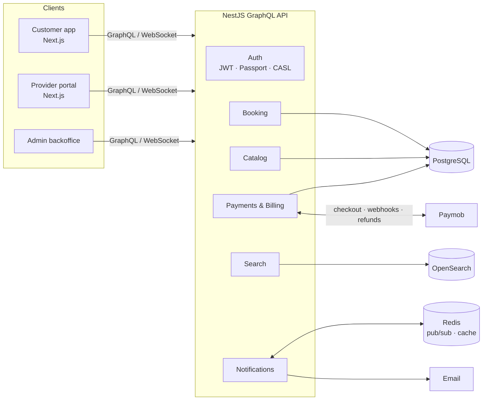

# Hogozaty — Service Booking Marketplace

A multi-sided marketplace that connects customers with service providers, organized by service category. Customers discover nearby stores, book time slots and pay online. Providers manage stores, offers and reservations. Admins run the platform from a backoffice.

> The main codebase is private. This repository documents the architecture and includes a few
> representative files taken directly from the project. Happy to walk through the full code in an interview.

## Architecture

The API is a pnpm monorepo: the NestJS app plus shared workspace packages (`auth-core`, `email`, `notifications-core`, `graphql-types`, `ui-tokens`) that the frontends reuse.

## Module map

| Module | Responsibility |
| --- | --- |
| `auth` | JWT + Passport for three actor types (customer, provider, admin), CASL authorization |
| `catalog` | Categories, services, offers, stores (Arabic & English) |
| `booking` | Reservations, availability, cart checkout |
| `payments` / `billing` | Payment intents, webhooks, refunds, PDF invoices |
| `search` | OpenSearch full-text + geo-distance store discovery, event-driven index sync |
| `in-app-notifications` | Persisted notifications + GraphQL subscriptions over Redis pub/sub |
| `reviews` | Store-scoped customer reviews |
| `platform-settings` | Runtime SMTP, branding and feature flags |
| `dashboard` / `health` | Aggregated metrics, liveness/readiness checks |

## Engineering highlights

**No double bookings, guaranteed by the database.** A PostgreSQL exclusion constraint (`tstzrange` + GiST) rejects overlapping confirmed reservations for the same provider, so race conditions can't create conflicting bookings even under concurrent requests.
→ [`samples/booking/…SlotExclusion.ts`](samples/booking/1746360000000-Level05SlotExclusion.ts)

**Role-based authorization with CASL.** Customers only see their own reservations, providers only their own, admins manage everything, all defined in one ability factory.
→ [`samples/auth/casl-ability.factory.ts`](samples/auth/casl-ability.factory.ts)

**Pluggable payment gateways.** Paymob and a manual gateway implement one `PaymentGateway` interface (checkout, refund, HMAC-verified webhooks), with idempotency keys and minor-unit amounts.
→ [`samples/payments/payment-gateway.interface.ts`](samples/payments/payment-gateway.interface.ts)

**Bilingual geo search.** OpenSearch queries combine geo-distance filtering, weighted Arabic/English text fields, rating filters and multiple sort modes, all unit-tested.
→ [`samples/search/`](samples/search/)

**No N+1 queries in GraphQL.** Request-scoped DataLoaders batch entity lookups across resolvers.
→ [`samples/graphql/domain-loaders.service.ts`](samples/graphql/domain-loaders.service.ts)

**Production hardening.** Redis caching, rate limiting (`@nestjs/throttler`), Helmet, health checks (`@nestjs/terminus`), 36 TypeORM migrations, Docker Compose for dev and prod, Jest unit and e2e tests.

## Author

**Salem Ouda**, Senior Software Engineer
[LinkedIn](https://www.linkedin.com/in/salem-hassan/) · [GitHub](https://github.com/Salem4dev) · salem4work@gmail.com
